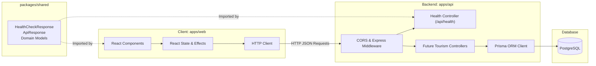

# System Architecture & Monorepo Design

## 1. Overview
The Tourist Website platform (**VoyageVista**) is architected as an enterprise-grade TypeScript monorepo. It cleanly separates the client application, backend REST service, and domain contracts while providing shared typing, synchronized builds, and consistent developer ergonomics.

## 2. Directory Layout

```text
tourist-website/
├── apps/
│   ├── web/                     # Client application (React + Vite + Tailwind CSS)
│   │   ├── src/
│   │   │   ├── test/            # Vitest setup & component tests
│   │   │   ├── App.tsx          # Landing & shell view
│   │   │   ├── index.css        # Tailwind CSS layers & design tokens
│   │   │   └── main.tsx         # React DOM mount point
│   │   ├── index.html           # SEO-optimized HTML entry point
│   │   ├── package.json
│   │   ├── tailwind.config.ts   # Curated visual design tokens
│   │   ├── tsconfig.json
│   │   └── vite.config.ts       # Vite bundler & API dev proxy
│   └── api/                     # Backend REST service (Node.js + Express + TypeScript)
│       ├── prisma/
│       │   └── schema.prisma    # PostgreSQL data model declarations
│       ├── src/
│       │   ├── routes/          # Express route controllers (e.g., /api/health)
│       │   ├── app.ts           # Middleware pipeline & route mounting
│       │   └── index.ts         # Server lifecycle & graceful shutdown
│       ├── tests/               # API integration tests (Supertest + Vitest)
│       ├── package.json
│       └── tsconfig.json
├── packages/
│   └── shared/                  # Type definitions, enums & API response contracts
│       ├── src/
│       │   └── index.ts         # Shared DTOs, health contracts, domain types
│       ├── package.json
│       └── tsconfig.json
├── docs/                        # Architecture, setup, database, API & deployment specifications
│   ├── ARCHITECTURE.md
│   ├── SETUP.md
│   ├── DATABASE.md
│   ├── API.md
│   └── DEPLOYMENT.md
├── package.json                 # Monorepo workspaces & orchestration scripts
├── tsconfig.base.json           # Shared strict TypeScript configuration
├── .gitignore                   # Workspace-wide git exclusion rules
├── .env.example                 # Root environment template
└── README.md                    # Project onboarding guide
```

## 3. Technology Stack Rationale

| Layer | Technology | Architectural Rationale |
|---|---|---|
| **Client** | React 18 + Vite | Blazing fast HMR, sub-second build times, native ESM support, and modular component lifecycle. |
| **Styling** | Tailwind CSS v3 | Utility-first styling with consistent design tokens, eliminating CSS bloat and preventing style regressions. |
| **API** | Node.js + Express | Lightweight, reliable REST server with battle-tested middleware ecosystem and predictable event loop performance. |
| **Data Access** | Prisma ORM | Type-safe query generation directly from PostgreSQL schema, automated migrations, and schema drift prevention. |
| **Database** | PostgreSQL | Robust ACID compliance, strong relational integrity, relational joins, and rich indexing support. |
| **Contracts** | `@tourist/shared` | Single source of truth for request/response payloads, eliminating manual client-server sync errors. |
| **Hosting** | Vercel (Web) + Node/PaaS (API) | Global edge CDN for static assets, serverless or containerized deployment for the backend. |

## 4. Data Flow & Communication



## 5. Architectural Principles
1. **Contract-First Communication**: Endpoint shapes and payloads are formalized in `@tourist/shared` before client or server implementation.
2. **Boundary Validation**: External network input is validated at the edge using standardized error envelopes before reaching services.
3. **Strict Type Safety**: `tsconfig.base.json` enforces `strict: true`, `noImplicitAny: true`, and `noUncheckedIndexedAccess: true` across all packages.
4. **Resilient Server Lifecycle**: The Express application handles `SIGTERM` and `SIGINT` to allow in-flight connections to drain gracefully before process termination.
